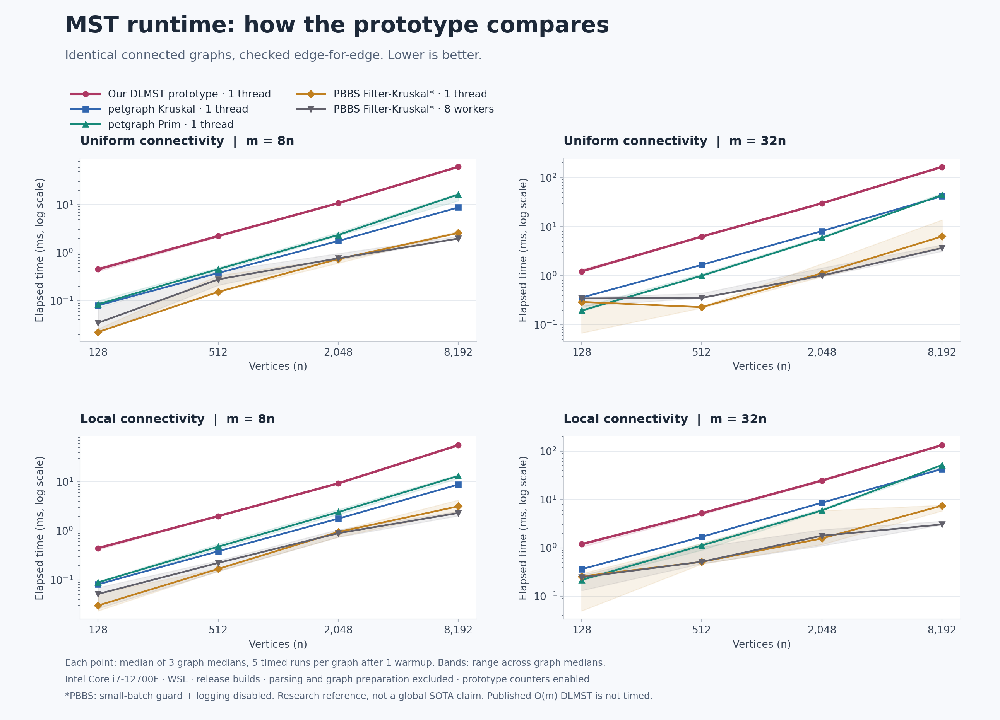

# DLMST in Rust: a brief AI-implemented example

**This is a brief example implemented by an AI coding assistant, without
performance optimization.** It is intended for learning and exploratory
experiments. It is not an official implementation, a complete reproduction of
the paper's deterministic linear-time algorithm, or a competitive MST solver.

This project implements and tests the certificate mechanisms in **A Deterministic
Linear Time Algorithm for Minimum Spanning Tree** (Khanna, Putterman, Song, 2026).
It returns an exact minimum spanning forest, including for disconnected graphs,
parallel edges, negative weights and equal weights.

Small experimental parameters and a simple deterministic schedule make the
interesting branches runnable. Conventional exact MSF subroutines and bounded
fallbacks preserve correctness. Their use is reported, and the documented tests
and benchmarks describe the checks performed; they do not validate the full
theoretical result.

## Run

Rust 1.86 or newer is required. Dependencies are pinned in `Cargo.lock`.

```sh
cargo run --release --locked -- solve examples/small.json --verify
cargo run --release --locked -- demo --vertices 64 --edges 512 --seed 42 \
  --boruvka-steps 0 --base-case-edges 0
cargo run --release --locked -- bench --sizes 64,256,1024 --repetitions 3
```

On Windows, the project has been tested with Rust in WSL Ubuntu. From the cloned
project directory in a WSL terminal, use the same commands above.

`solve` accepts a JSON filename, or `-` for standard input:

```json
{
  "vertices": 3,
  "edges": [
    {"u": 0, "v": 1, "weight": 4},
    {"u": 1, "v": 2, "weight": -2},
    {"u": 0, "v": 2, "weight": 1}
  ]
}
```

Vertices use zero-based indices. Weights are signed 64-bit integers, accessed by
comparison inside the solver; no integer-weight sorting trick is used. An edge's
array position is its ID. Equal weights are ordered by ID, and self-loops are
discarded. The output includes sorted selected IDs, a 128-bit total weight,
component count (including isolated vertices), timings and operation counters.
The example above returns IDs `[1, 2]`, total weight `-1`, and one component.

`--verify` compares the complete edge-ID set with `petgraph`'s MST routine. `demo`
and `bench` always verify. Reference graph construction is included in reference
timing; input parsing, JSON output and graph generation are outside solver timing.
Bench output omits the selected IDs to keep result files small.

## What is implemented

- Boruvka contraction and recursive certificate-based cycle filtering.
- Portals, spokes, projections, lifting and rejection at the first invalid level.
- Grouped admissible-edge selection from Lemma 3.3 and the portal hitting set.
- Exhaustive symbolic preference families and distinguishing subsets on tiny
  instances; exact preferred-action queries on larger instances.
- Comparison counts by operation, plus explicit base-case, no-progress and
  certificate-depth fallback counts.

`petgraph` supplies union-find and the independent MST reference. Rust's standard
selection routine partitions batches. `clap`, `serde` and `serde_json` handle the
CLI and data; `rand` generates seeded experiments; `proptest` generates test cases.

See [the reproduction boundaries](docs/reproduction.md) for the paper-to-code
mapping and [validation results](docs/validation.md) for measured behavior.

For runtime charts against PBBS Filter-Kruskal (1 and 8 workers) and petgraph
Kruskal/Prim, see [the measured performance comparison](docs/performance-comparison.md).



## Test

```sh
PROPTEST_RNG_SEED=20261124 cargo test --locked
cargo clippy --all-targets --locked -- -D warnings
cargo fmt --check
```

The tests compare against `petgraph`, independently check the cycle property,
enumerate all four-vertex graphs with absent/negative/zero-weight edges, and test
projection rejection through two recursion levels. Run `cargo run -- --help` or
`cargo run -- demo --help` for experiment options.

## Sources

- [Official DLMST repository](https://github.com/Louiealbp/DLMST)
- [Paper at the inspected revision](https://github.com/Louiealbp/DLMST/blob/0072335716b145032b418760883daed2a89809db/final.pdf)

The Rust implementation was written independently from the paper's algorithm
description; the upstream repository contains papers rather than executable code.
Project code is provided under the [MIT license](LICENSE). External benchmark
dependencies retain their upstream licenses.
